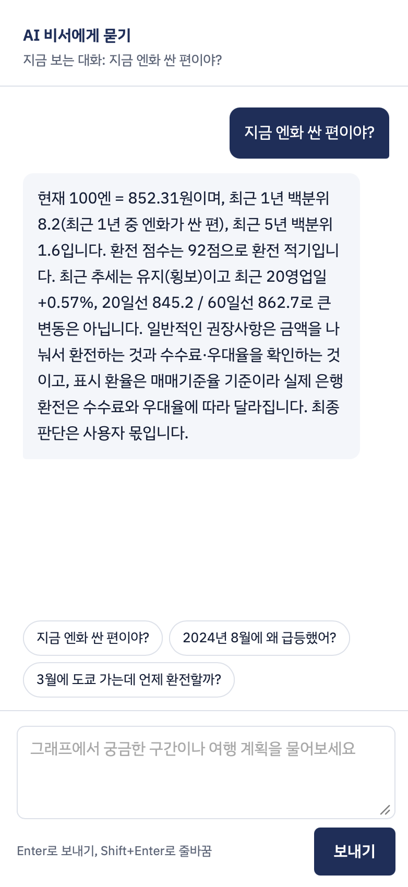
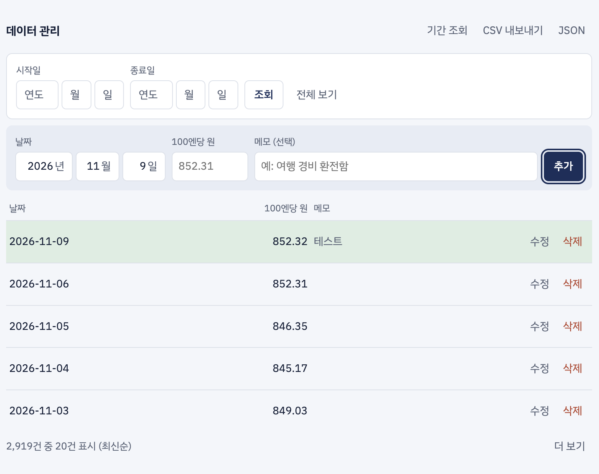
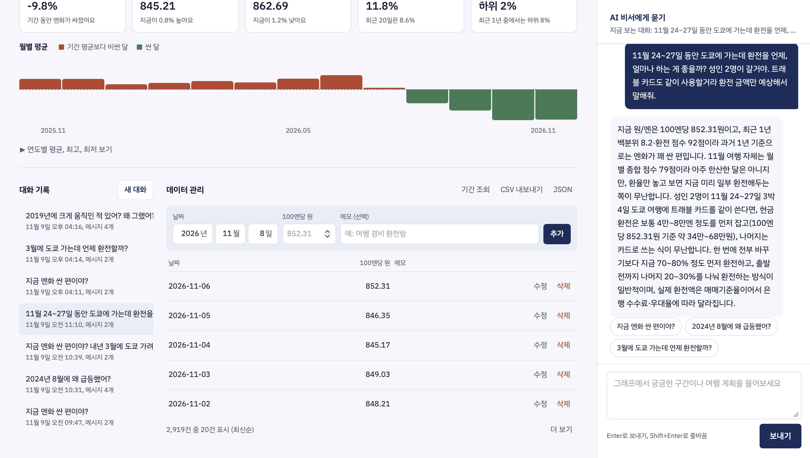
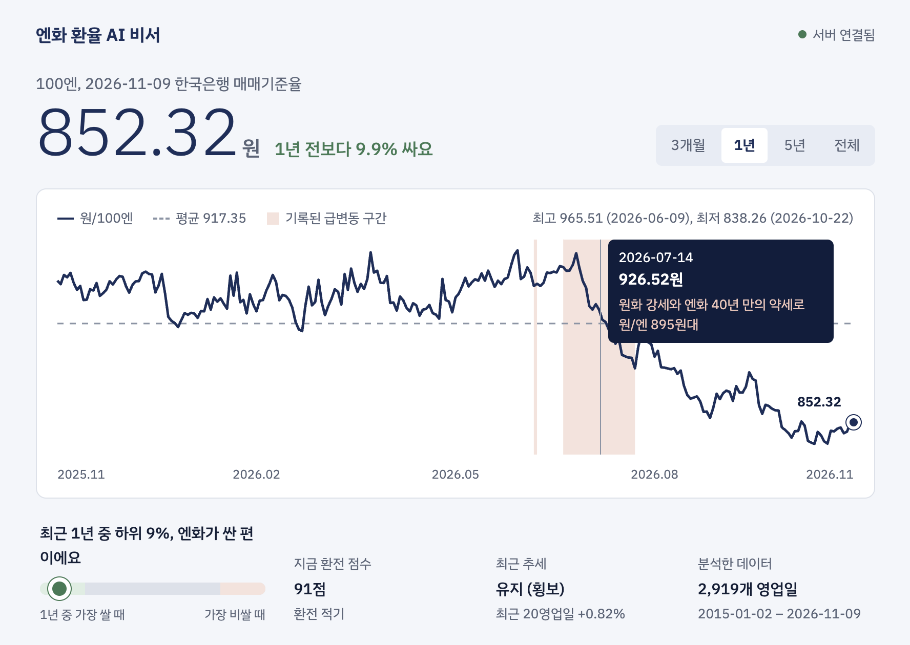
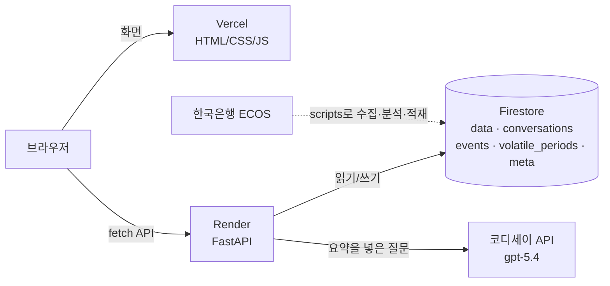

# 엔화 환율 AI 비서

2015년부터 약 11년 치 원/엔 환율 데이터를 알고 답하는 AI 비서입니다.
"지금 엔화가 싼 편인지", "그때 왜 그렇게 움직였는지", "여행 환전은 언제 하면 좋을지"를 실제 데이터와 기록된 이유를 근거로 답합니다.

| 구분 | 주소 |
|---|---|
| 서비스 (프론트엔드) | https://yen-ai.vercel.app |
| 백엔드 API | https://yen-ai-api.onrender.com |
| API 문서 (Swagger) | https://yen-ai-api.onrender.com/docs |

> **처음 접속하면 최대 1분 걸릴 수 있어요.** 백엔드가 Render 무료 플랜이라 15분 동안 요청이 없으면 서버가 잠듭니다. 화면 위에 "서버를 깨우는 중" 안내가 뜨고, 서버가 깨면 오른쪽 위가 **서버 연결됨**으로 바뀝니다.

## 스크린샷

**1. 요약을 아는 AI 채팅.** 왼쪽은 최신 환율, 1년 그래프, 최근 1년 중 위치이고, 오른쪽 AI는 이 요약을 바탕으로 답합니다.



**2. 데이터 관리 (CRUD).** 날짜별 환율을 추가, 조회(기간 필터, 더 보기), 수정, 삭제합니다. 바꾸면 요약과 그래프가 바로 다시 계산됩니다.



**3. 대화 기록 불러오기.** 대화는 자동 저장되고, 목록에서 누르면 전체 메시지를 다시 불러와 이어서 질문할 수 있습니다.



**4. 그래프 (보너스).** 3개월, 1년, 5년, 전체 기간을 고를 수 있습니다. 분홍 띠는 이유가 기록된 급변동 구간이고, 마우스를 올리면 그날 환율과 이유가 나옵니다.



**5. 다크 모드 (보너스).** 처음에는 기기의 다크 모드 설정을 따르고, 오른쪽 위 버튼으로 바꿀 수 있습니다.


## 무엇을 해결하나요

| 문제 | 이 서비스의 답 |
|---|---|
| 일반 챗봇은 "지금 엔화 싸?"에 일반론만 답한다 | 최근 1년 중 몇 % 위치인지, 1년 평균과 비교해 답한다 |
| 환율이 급변한 이유가 뉴스에 흩어져 있다 | 급변동 26구간을 계산하고, 그중 이유를 확인한 23건을 기사 링크와 함께 저장했다 |
| 환전 시점은 환율과 여행 시즌을 같이 봐야 한다 | 월별 여행 혼잡도와 환율 위치를 합친 "환전 점수"로 답한다 |

질문 예시:
- 지금 엔화 싼 편이야?
- 2024년 8월에 왜 급등했어?
- 3월에 도쿄 가는데 언제 환전할까?

## 주요 기능

| 구분 | 기능 |
|---|---|
| 필수 | Data API 5개 (추가, 목록, 수정, 삭제, 요약) |
| 필수 | 대화 API (저장, 목록, 불러오기, 삭제). 옵션 (A): 목록에서 대화를 눌러 이어서 질문 |
| 필수 | AI 채팅: 데이터 요약을 시스템 프롬프트에 넣어 답하고, 대화를 자동 저장 |
| 필수 | 바닐라 HTML/CSS/JS 화면: 채팅, 데이터 관리, 대화 기록 |
| 보너스 B | 기간 선택 그래프, 급변동 구간 표시와 말풍선, CSV/JSON 내보내기, 다크 모드 (시스템 설정을 따르고, 버튼으로 바꾼 값은 브라우저에 기억) |

## 기술 스택

| 영역 | 사용 기술 |
|---|---|
| 백엔드 | Python 3.14, FastAPI, Pydantic v2, Uvicorn |
| 데이터베이스 | Firebase Firestore (firebase-admin) |
| AI | 코디세이 OpenAI 호환 API (`/v1/chat/completions`), 모델 `gpt-5.4` |
| 프론트엔드 | HTML, CSS, JavaScript (프레임워크 없음), 그래프는 직접 그린 SVG |
| 데이터 수집과 분석 | 한국은행 ECOS Open API, pandas, numpy |
| 배포 | Render (백엔드), Vercel (프론트엔드) |

## 구조



### AI 채팅이 답을 만드는 순서

1. 프론트가 `POST /api/chat`으로 질문을 보낸다.
2. 백엔드가 데이터 요약을 가져온다. 요약은 메모리에 먼저 찾고, 없으면 Firestore `meta/summary` 문서 1개를 읽고, 그것도 없으면 전체 데이터로 새로 계산한다. 그래서 채팅 1번에 Firestore 읽기는 보통 0~1회다.
3. 요약을 시스템 프롬프트(약 3,400자)로 만든다.
   - 최신 환율과 날짜
   - 1년, 5년 평균, 최고, 최저
   - 최근 1년 중 위치(백분위)와 추세
   - 큰 급변동 5구간과 그 이유
   - 기록된 이유 23건 전체
   - 월별 여행 환전 점수
4. 같은 대화의 최근 메시지 10개를 함께 보내 맥락을 이어 간다.
5. AI 답을 받아 `conversations`에 저장하고(새 대화면 제목 자동 생성), 답과 대화 ID를 돌려준다.

프롬프트에는 다음 규칙도 넣었다.
- 데이터에 없는 숫자나 이유는 지어내지 않는다.
- 미래 환율은 예측하지 않는다.
- 실제 환전 때는 수수료가 붙는다는 점을 알린다.
- 3~5문장으로 답한다.

데이터를 추가, 수정, 삭제하면 전체를 다시 읽지 않고 바뀐 1건만 캐시(`meta/series`)에 반영한 뒤 요약을 다시 계산한다. 그래서 데이터 변경 1번에 Firestore 읽기는 0건이다.

## API

| Method | 경로 | 설명 |
|---|---|---|
| GET | `/health` | 서버 상태 확인 (프론트가 서버를 깨울 때도 사용) |
| POST | `/api/data` | 데이터 추가 (같은 날짜가 있으면 409) |
| GET | `/api/data` | 목록 조회. `start`, `end`, `limit`, `order`, `cursor`로 기간 필터와 페이지 넘김 |
| PUT | `/api/data/{date}` | 환율, 메모 수정 |
| DELETE | `/api/data/{date}` | 삭제 |
| GET | `/api/data/summary` | AI 프롬프트에 넣는 요약 |
| GET | `/api/data/series?range=3m\|1y\|5y\|all` | 그래프용 시계열 (최대 400점, 최고·최저점은 유지) |
| GET | `/api/data/export?format=csv\|json` | 전체 데이터 내려받기 (CSV는 엑셀에서 한글이 깨지지 않게 UTF-8 BOM) |
| POST | `/api/conversations` | 대화 저장 |
| GET | `/api/conversations` | 대화 목록 (최근 순, 메시지 본문 제외) |
| GET | `/api/conversations/{id}` | 대화 전체 불러오기 |
| DELETE | `/api/conversations/{id}` | 대화 삭제 |
| POST | `/api/chat` | AI 채팅 (요약 주입, 대화 자동 저장) |

요청 본문과 예시는 [Swagger](https://yen-ai-api.onrender.com/docs)에서 바로 실행해 볼 수 있습니다.

## Firestore 구조

| 컬렉션 | 문서 ID | 필드 |
|---|---|---|
| `data` | 날짜 (`2026-11-06`) | `date`, `value` (100엔당 원), `memo`, `created_at`, `updated_at` |
| `conversations` | 자동 ID | `title`, `messages` [{`role`, `content`}], `message_count`, `created_at`, `updated_at` |
| `events` | `ev-{시작일}` | `start_date`, `end_date`, `title`, `category`, `direction`, `description`, `source_url` |
| `volatile_periods` | `vp-{시작일}-{유형}` | 구간, 변동률, 원화·엔화 요인 비중 |
| `meta` | `summary`, `series` | 요약과 그래프 데이터 캐시 (데이터가 바뀌면 삭제) |

날짜를 문서 ID로 써서 같은 날짜가 두 번 들어가지 않게 했습니다.

## 데이터 출처

- **환율:** [한국은행 경제통계시스템(ECOS)](https://ecos.bok.or.kr) Open API, 통계표 `731Y001` (주요국 통화의 대원화환율, 일별 매매기준율)
  - 원/100엔 (`0000002`): 2015-01-02 ~ 2026-11-06, 2,918영업일
  - 원/달러 (`0000001`): 급변동 원인을 원화 요인과 엔화 요인으로 나누는 데 사용
- **급변동 구간:** `backend/scripts/analyze.py`가 아래 기준 중 하나에 맞는 날을 찾아 구간으로 묶었습니다. 결과는 26구간입니다.
  - 하루 3% 이상 움직인 날
  - 직전 60영업일 평소 변동폭의 4배 이상 움직인 날
  - 20영업일 동안 6% 이상 움직인 경우
- **급변동 이유:** 이 중 23건은 당시 기사로 이유를 확인해 `backend/data/events.json`에 출처 링크와 함께 정리했습니다.
- **여행 시즌:** `backend/data/travel_calendar.json`. 월별 일본 여행 혼잡도를 직접 점수로 매긴 참고값입니다.

<details>
<summary>기록된 급변동 이유 23건과 출처 (펼치기)</summary>

방향은 원/엔 환율 기준입니다. 상승은 엔화가 비싸진 것, 하락은 엔화가 싸진 것입니다.

| 기간 | 방향 | 이유 | 출처 |
|---|---|---|---|
| 2015-07-28 ~ 2015-09-09 | 상승 | 중국 위안화 기습 절하로 원화 약세 | [seoul.co.kr](https://m.seoul.co.kr/news/2015/08/11/20150811800166) |
| 2015-10-01 ~ 2015-10-29 | 하락 | 미국 10월 금리인상 기대 후퇴로 원화 반등 | [news.bizwatch.co.kr](https://news.bizwatch.co.kr/article/market/2015/10/05/0002) |
| 2015-12-08 ~ 2016-03-25 | 상승 | 글로벌 금융시장 불안과 마이너스 금리 역효과로 엔화 강세 | [seoul.co.kr](https://m.seoul.co.kr/news/2016/02/12/20160212800074) |
| 2016-06-24 ~ 2016-06-27 | 상승 | 브렉시트 국민투표 충격 | [seoul.co.kr](https://m.seoul.co.kr/news/2016/06/24/20160624800115) |
| 2016-11-04 ~ 2016-12-16 | 하락 | 트럼프 당선 후 미국 금리 상승으로 엔화 약세 | [gulf-times.com](https://gulf-times.com/story/520894/yen-bears-awaken-as-trump-win-hands-kuroda-unexpected-gift) |
| 2018-01-10 ~ 2018-02-19 | 상승 | 글로벌 증시 급락 후 엔화 15개월 최고 | [investing.com](https://www.investing.com/news/forex-news/yen-climbs-to-15month-high-hitting-japan-stocks-markets-wrap-1242459) |
| 2018-12-05 ~ 2019-01-04 | 상승 | 연초 엔화 플래시 크래시 | [rba.gov.au](https://www.rba.gov.au/publications/smp/2019/feb/box-b-the-recent-japanese-yen-flash-event.html) |
| 2019-04-15 ~ 2019-04-26 | 상승 | 1분기 역성장 쇼크로 원화 약세 | [thestar.com.my](https://www.thestar.com.my/business/business-news/2019/04/26/s-korea-gdp-shock-contraction-hits-won) |
| 2019-05-01 ~ 2019-05-27 | 상승 | 미·중 무역분쟁 재격화로 원/엔 1,080원대 | [etoday.co.kr](https://www.etoday.co.kr/news/view/1755049) |
| 2019-07-29 ~ 2019-08-26 | 상승 | 일본 화이트리스트 배제와 위안화 7위안 돌파 | [newsis.com](https://www.newsis.com/view/NISX20190805_0000732459) |
| 2020-02-12 ~ 2020-03-20 | 상승 | 코로나19 팬데믹 달러 부족으로 원화 급락 | [newsis.com](https://www.newsis.com/view/NISX20200319_0000962921) |
| 2020-11-09 ~ 2020-11-10 | 하락 | 화이자 백신 효과 발표로 엔화 약세 | [ng.investing.com](https://ng.investing.com/news/forex-news/forexyen-plunges-as-traders-add-risk-for-future-with-vaccine-biden-302234) |
| 2022-03-10 ~ 2022-04-14 | 하락 | 일본은행 나홀로 완화로 엔화 급락 | [mt.co.kr](https://www.mt.co.kr/economy/2022/04/03/2022040117325220503) |
| 2022-11-10 ~ 2022-11-11 | 상승 | 미국 물가 둔화 발표로 달러 급락 | [biz.sbs.co.kr](https://biz.sbs.co.kr/amp/article/20000088964) |
| 2022-12-20 ~ 2022-12-21 | 상승 | 일본은행 장기금리 변동폭 확대(사실상 금리인상) | [fnnews.com](https://www.fnnews.com/news/202212201809024387) |
| 2023-05-08 ~ 2023-06-21 | 하락 | 일본은행 완화 유지로 원/엔 8년 만에 800원대 | [etoday.co.kr](https://www.etoday.co.kr/news/view/2258406) |
| 2023-11-13 ~ 2023-12-14 | 상승 | 우에다 총재 발언에 마이너스 금리 종료 기대 | [omanobserver.om](https://www.omanobserver.om/ampArticle/1146609) |
| 2024-07-05 ~ 2024-08-14 | 상승 | 일본은행 금리인상과 엔캐리 트레이드 청산 | [kbthink.com](https://kbthink.com/main/economy/market-analysis/Issue-analysis/2024/issue-analysis-240806.html) |
| 2025-04-11 ~ 2025-05-13 | 하락 | 대만달러 급등과 달러 약세로 원화 강세 | [kbthink.com](https://kbthink.com/main/economy/issue_and_news/exchange-issue-report/2025/exchange-issue-report-250508.html) |
| 2025-05-01 ~ 2025-05-02 | 하락 | 일본은행 금리 동결·전망 하향으로 엔화 약세 | [freemalaysiatoday.com](https://www.freemalaysiatoday.com/category/business/2025/05/01/yen-slides-as-tariffs-keep-boj-on-hold-dollar-edges-higher) |
| 2025-10-04 ~ 2025-10-10 | 하락 | 다카이치 자민당 총재 당선으로 엔화 약세 | [ajunews.com](https://www.ajunews.com/view/20251009153956741) |
| 2026-06-16 | 혼조 | 일본은행 기준금리 1%로 인상 | [mt.co.kr](https://www.mt.co.kr/world/2026/07/12/2026071014321738641) |
| 2026-06-29 ~ 2026-07-30 | 하락 | 원화 강세와 엔화 40년 만의 약세로 원/엔 895원대 | [hankyung.com](https://www.hankyung.com/article/2026072666311) |

</details>

## 로컬에서 실행하기 (Mac)

준비물:
- Python 3.14
- Firebase 프로젝트와 서비스 계정 키(JSON)
- 코디세이 API 키
- (데이터를 직접 모을 때만) 한국은행 ECOS 인증키

### 1. 백엔드

```bash
git clone https://github.com/riakwjddd06/yen-ai.git
cd yen-ai/backend
python3 -m venv venv
source venv/bin/activate
pip install -r requirements.txt
cp .env.example .env        # .env를 열어 키 값을 채운다
uvicorn app.main:app --reload
```

http://127.0.0.1:8000/docs 가 열리면 성공입니다. Firebase 키 파일은 `backend/serviceAccount.json`으로 저장합니다. 이 파일은 `.gitignore`에 들어 있어 GitHub에 올라가지 않습니다.

### 2. 데이터 적재 (처음 한 번)

저장소에 수집, 분석이 끝난 `data/processed/*.csv`와 `data/events.json`이 들어 있어서, 바로 Firestore에 적재할 수 있습니다.

```bash
pip install -r requirements-scripts.txt
python scripts/seed_firestore.py --dry-run   # 쓰지 않고 건수만 확인
python scripts/seed_firestore.py             # 실제 적재 (약 3,000건 쓰기)
```

최신 데이터로 다시 모으려면 `.env`에 `ECOS_API_KEY`를 넣고, 적재 전에 아래를 먼저 실행합니다.

```bash
python scripts/fetch_ecos.py   # ECOS에서 환율 수집 → data/processed/rates.csv
python scripts/analyze.py      # 급변동 구간 계산 → data/processed/volatile_periods.csv
```

### 3. 프론트엔드

새 터미널 탭에서 실행합니다.

```bash
cd yen-ai/frontend
API_BASE_URL=http://127.0.0.1:8000 sh build.sh   # config.js 생성
python3 -m http.server 5500
```

http://127.0.0.1:5500 을 엽니다. 백엔드 `.env`의 `ALLOWED_ORIGINS`에 `http://127.0.0.1:5500`이 있어야 연결됩니다.

## 환경변수

키 값은 `.env`(로컬)와 Render·Vercel 설정 화면(배포)에만 넣고 저장소에는 올리지 않습니다. 이름만 적은 예시는 `backend/.env.example`에 있습니다.

| 이름 | 어디에 | 설명 | 예시 |
|---|---|---|---|
| `OPENAI_API_KEY` | 백엔드 | 코디세이에서 발급받은 가상 키 | (비공개) |
| `OPENAI_BASE_URL` | 백엔드 | 코디세이 OpenAI 호환 주소 | `https://copa.codyssey.kr/v1` |
| `OPENAI_MODEL` | 백엔드 | 채팅 모델 | `gpt-5.4` |
| `OPENAI_MAX_COMPLETION_TOKENS` | 백엔드 | 답 하나의 토큰 상한 | `3000` |
| `CHAT_RATE_LIMIT_PER_MIN` | 백엔드 (선택) | IP당 분당 채팅 횟수 | `10` |
| `FIREBASE_SERVICE_ACCOUNT_JSON` | 백엔드 (배포) | 서비스 계정 JSON 내용 전체 | (비공개) |
| `FIREBASE_CREDENTIALS_PATH` | 백엔드 (로컬) | 키 파일 경로, `backend` 폴더 기준 | `serviceAccount.json` |
| `ALLOWED_ORIGINS` | 백엔드 | 요청을 허용할 프론트 주소, 쉼표로 구분 | `https://yen-ai.vercel.app,http://127.0.0.1:5500` |
| `ECOS_API_KEY` | 수집 스크립트 | 한국은행 ECOS 인증키 | (비공개) |
| `API_BASE_URL` | 프론트 (Vercel) | 백엔드 주소. `build.sh`가 `config.js`로 만듦 | `https://yen-ai-api.onrender.com` |

## 배포

| 항목 | Render (백엔드) | Vercel (프론트엔드) |
|---|---|---|
| Root Directory | `backend` | `frontend` |
| Build | `pip install -r requirements.txt` | `sh build.sh` (`vercel.json`에 지정) |
| Start / Output | `uvicorn app.main:app --host 0.0.0.0 --port $PORT` | `.` (정적 파일) |
| 기타 | Region Singapore, Health Check `/health` | Application Preset `Other` |

Vercel 주소를 Render의 `ALLOWED_ORIGINS`에 넣어야 브라우저가 API를 호출할 수 있습니다(CORS).

## 안전장치와 비용 관리

- **키 보호:** `.env`, `serviceAccount.json`, `frontend/config.js`는 `.gitignore`로 제외했습니다.
- **입력 검증 (Pydantic):**
  - 환율 300~3,000원, 미래 날짜 금지, 메모 200자
  - 질문 500자, 메시지 4,000자, 빈 문자열 거부
- **오류 응답:** 화면은 모든 오류를 한국어 문장으로 보여 줍니다.
  - 404: 없는 데이터
  - 409: 같은 날짜 중복
  - 422: 입력 오류
  - 429: 요청 과다
  - 503: DB 연결 실패, 또는 Firestore 무료 한도 초과 (초기화 시간 안내)
  - 502: AI 응답 실패
- **AI 비용:**
  - 토큰 상한
  - 이전 대화는 최근 10개만 함께 보냄
  - IP당 분당 10회 채팅 제한
- **Firestore 무료 한도:**
  - 요약, 그래프, 내보내기는 메모리와 `meta` 문서 캐시를 써서 요청마다 2,900건을 다시 읽지 않습니다.
  - 데이터를 추가, 수정, 삭제할 때도 바뀐 1건만 캐시에 반영합니다. 처음에는 변경 때마다 캐시를 지우고 전체를 다시 읽었는데, 테스트 중에 하루 읽기 한도를 다 써서 이렇게 바꿨습니다.
  - 목록은 20건씩 커서로 나눠 읽습니다.
- **화면 보안:**
  - 사용자 입력과 AI 답은 `textContent`로 넣어 스크립트가 실행되지 않게 했습니다.
  - 한글 입력 중 Enter로 잘못 전송되지 않게 막았습니다.

## 폴더 구조

```
yen-ai/
├─ backend/
│  ├─ app/
│  │  ├─ main.py              # FastAPI 앱, CORS, 라우터 등록
│  │  ├─ core/                # 설정, Firebase 연결, 오류 처리, 요청 제한
│  │  ├─ schemas/             # Pydantic 요청·응답 모델
│  │  ├─ routers/             # data, conversations, chat API
│  │  └─ services/            # 비즈니스 로직 (요약 계산, 프롬프트, AI 호출, DB)
│  ├─ scripts/                # ECOS 수집, 급변동 분석, Firestore 적재
│  ├─ data/                   # rates.csv, volatile_periods.csv, events.json, travel_calendar.json
│  ├─ requirements.txt
│  └─ .env.example
└─ frontend/
   ├─ index.html
   ├─ style.css
   ├─ api.js                  # API 호출을 한곳에 모음
   ├─ app.js                  # 화면 동작
   ├─ build.sh                # API_BASE_URL → config.js
   └─ vercel.json
```

## 한계

- 환율은 한국은행 **매매기준율**입니다. 실제 환전할 때는 은행 수수료(스프레드)가 붙습니다.
- AI는 미래 환율을 예측하지 않습니다. 과거 데이터 안에서의 위치와 기록된 이유만 근거로 답합니다.
- 데이터는 수집 시점(2026-11-06)까지입니다. 새 날짜는 화면에서 직접 추가하거나 수집 스크립트를 다시 실행해야 합니다.
- 무료 서버라 처음 접속할 때 최대 1분 걸립니다.
