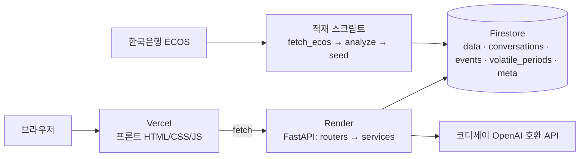

# 엔화 환율 AI 비서 기획서

> 구현을 시작하기 전에 쓴 기획서입니다. 맨 위 진행 상황 표는 최종 결과(2026-11-09)를 반영했고, 본문의 설계는 기획 당시 그대로 두었습니다.
> 화면 배치(한 페이지 + 오른쪽 채팅), 모델(`gpt-5.4`), MCP 연결 방식(`/api/tools` 경유) 등 실제 구현과 달라진 부분은 [README](../README.md)가 기준입니다.

Nov 4, 2026 · @김하정

## 진행 상황

단계를 끝낼 때마다 상태를 바꾸고 완료일을 적습니다. 단계별 세부 항목은 8장 체크리스트에 있습니다.

| 단계 | 내용 | 구분 | 상태 | 완료일 | 메모 |
| --- | --- | --- | --- | --- | --- |
| 1 | 환경 준비(venv, 패키지, 각종 키·계정) | 필수 | 완료 | 2026-11-08 | Python 3.14 venv, 코디세이 API·Firebase·ECOS 키 준비, GitHub 저장소 |
| 2 | 데이터 수집·분석(ECOS, 급변동, events) | 필수 | 완료 | 2026-11-08 | 2,918건(2015-01-02\~2026-11-06), 급변동 26구간, 이유 23건(기사 링크). 11-13에 2026-11-12까지 덧붙여 2,922건 |
| 3 | FastAPI 뼈대(CORS, /docs) | 필수 | 완료 | 2026-11-08 | /docs 표시, /health 200 확인 |
| 4 | Firestore 연동·데이터 적재 | 필수 | 완료 | 2026-11-08 | data·events·volatile\_periods 적재, 콘솔에서 확인 |
| 5 | Data API(CRUD 4개 + summary) | 필수 | 완료 | 2026-11-08 | API 5개 + Pydantic 검증, 요약 3단 캐시(메모리·meta/summary·재계산) |
| 6 | 대화 기록 API | 필수 | 완료 | 2026-11-09 | 옵션 (A): 목록은 messages 제외, /{id}로 전체 불러오기. 제목 자동 생성 |
| 7 | AI 채팅 API(컨텍스트 주입) | 필수 | 완료 | 2026-11-09 | 코디세이 gpt-5.4(reasoning\_effort는 미지원이라 빼고 토큰 한도 3000), 요약+이유 23건 주입(약 3,400자), 자동 저장, IP당 분당 10회 |
| 8 | 프론트엔드(바닐라) | 필수 | 완료 | 2026-11-09 | 네이비 디자인(오른쪽 채팅 고정), 그래프 기간 선택과 급변동 구간 말풍선, CSV/JSON 내보내기, 연·월·일 날짜 입력(목록+키보드) |
| 9 | 배포(Render·Vercel) | 필수 | 완료 | 2026-11-09 | 백엔드 https://yen-ai-api.onrender.com (Singapore, Free), 프론트 https://yen-ai.vercel.app, CORS는 ALLOWED\_ORIGINS로 허용 |
| 10 | README·스크린샷 | 필수 | 완료 | 2026-11-09 | 스크린샷 7장, 배포 URL 3개, 실행 방법, 환경변수, 데이터 출처(이유 23건 링크), 도구 호출 기록 표 |
| 11 | 인사이트·UX(통계, 그래프, 내보내기, 다크 모드) | 보너스 | 완료 | 2026-11-09 | 그래프(3개월\~전체), 내보내기는 8단계에서 완료. 다크 모드, 통계 API(이동평균·변동성·백분위·월별·연도별)와 20일 이동평균 선까지 코드 완료(11-09). 배포 후 확인 남음 |
| 12 | 도구 호출·멀티채널(Function Calling, MCP/GPT Actions) | 보너스 | 완료 | 2026-11-09 | 코디세이 tools 지원 확인(gpt-5.4, gpt-5-mini). 도구 6개 + 호출 루프(최대 3회) + 답 아래 ‘사용한 도구’ 표시 코드 완료. MCP 서버(mcp\_server/server.py, SDK v2.3)와 /api/tools도 코드 완료. Claude 데스크톱 연결 완료(실행 중). 웹 채팅·MCP 실제 호출 확인, README 호출 기록 표 작성(11-09) |
| 최종 | 최종 점검(배포 환경에서 대응표 확인) | 필수 | 완료 | 2026-11-09 | 저장소 비밀 정보 없음, 배포 데이터 2,918건 확인, 시크릿 창 콜드스타트·Swagger·입력 검증·대화 불러오기 통과 |

## 1. 개요

**서비스명: 엔화 환율 AI 비서** — 2015년부터 약 11년 치 원/엔 환율 데이터를 아는 AI 비서. 지금 환율이 싼지 비싼지, 크게 움직였던 때 왜 그랬는지, 일본 여행 환전을 언제 하면 좋을지를 데이터 근거로 답합니다.

**해결하려는 문제**

- 일반 챗봇은 "지금 엔화 싸?"에 일반론만 답한다. 기준이 되는 과거 분포(최근 1년·5년 대비 위치)를 모른다.
- 환율이 급변한 이유는 뉴스에 흩어져 있다. 날짜와 이유가 한곳에 정리된 데이터가 없다.
- 여행 환전 시점은 환율 수준과 여행 시즌(혼잡·항공권)을 함께 봐야 하는데, 둘을 같이 보여주는 도구가 드물다.

**핵심 사용자 시나리오**

| 시나리오 | 사용자 질문 예시 | 비서가 쓰는 데이터 |
| --- | --- | --- |
| 현재 수준 확인 | "지금 100엔에 얼마야? 최근 1년 중 싼 편이야?" | 최신값, 1년·5년 백분위, 이동평균 |
| 급변동 이유 | "2024년 8월 초에 엔화가 왜 급등했어?" | 급변동 구간 + events(이유·출처) + 원/엔 요인 분해 |
| 기간 비교 | "작년 이맘때보다 비싸?", "역대 최저는 언제야?" | 기간 통계, 최고·최저와 날짜 |
| 여행 적기 | "내년 3월 도쿄 가려는데 지금 환전할까?" | 백분위 기반 환율 점수 + 여행 시즌 캘린더 + 환전 시뮬레이션 |
| 기록 관리 | "오늘 환율 추가해줘"(화면에서 CRUD) | data 컬렉션 |

답변은 환율 예측이 아니라 **과거 데이터 기준의 위치와 근거**를 제시하는 데 집중합니다. 투자·환전 결정은 사용자 몫이라는 고지를 시스템 프롬프트에 넣습니다.

## 2. 데이터 설계

기본 데이터는 \*\*한국은행 ECOS의 일별 원/엔(100엔당) 매매기준율, 2015-01-02 \~ 현재(약 2,900건)\*\*입니다. 필수 조건 100건의 약 29배이고, 2016 브렉시트·2020 코로나·2022 슈퍼엔저·2024 엔캐리 청산·2026 엔저 재현까지 담깁니다. 2011 동일본대지진까지 넣고 싶으면 시작을 2010년으로 당기면 됩니다(약 4,100건).

### 2-1. 수집 대상과 출처

| 데이터 | 용도 | 출처 | 비고 |
| --- | --- | --- | --- |
| 원/엔(100엔) 일별 매매기준율 | 메인 시계열(value) | ECOS Open API, 통계표 731Y001(주요국 통화의 대원화환율), 항목 0000002 | 인증키 무료 발급. 코드는 첫 호출로 확인 |
| 원/달러 일별 매매기준율 | 급변동 원인 분해(원 요인 vs 엔 요인) | 같은 통계표, 항목 0000001 | 엔/달러는 두 환율로 계산 |
| 한·미·일 정책금리(월별) | 금리차 설명(선택) | ECOS 국제 주요국 정책금리 통계표 | 통계표 코드는 ECOS 통계목록에서 확인 |
| 급변동 이벤트(이유) | "왜?" 질문의 근거 | 직접 큐레이션한 events.json(기사·중앙은행 발표 링크 포함) | 20\~30건 목표 |
| 여행 시즌 캘린더 | 여행 적기 판단 | 직접 작성한 travel\_calendar.json | 골든위크·오봉·연말연시·벚꽃·단풍·한국 연휴 |

ECOS 호출 형식: `https://ecos.bok.or.kr/api/StatisticSearch/{인증키}/json/kr/1/10000/731Y001/D/20150101/20261103/0000002`. 샘플 키는 조회 건수가 제한되므로 개인 인증키를 발급받고, 안전하게 연도별로 나눠 받습니다. ECOS가 막히면 대안으로 FRED의 DEXJPUS(엔/달러)·DEXKOUS(원/달러)로 교차환율을 만들 수 있습니다.

### 2-2. (date, value, memo) 정의

| 필드 | 타입 | 의미 | 예시 |
| --- | --- | --- | --- |
| date | YYYY-MM-DD | 영업일(주말·공휴일 없음) | 2024-08-05 |
| value | float | 100엔당 원화 매매기준율 | 912.34(형식 예시) |
| memo | string(최대 200자) | 이벤트가 있는 날은 이유 요약, 없으면 빈 값 | 엔캐리 청산, 일본 증시 급락 |

memo는 시드 단계에서 events와 날짜를 맞춰 자동으로 채웁니다. 사용자는 CRUD 화면에서 "환전함", "여행 예약" 같은 개인 메모를 남길 수 있습니다.

### 2-3. 급변동 이유를 "데이터로" 받는 방법

이유는 두 층으로 저장합니다. 숫자로 계산되는 **정량 근거**와, 출처가 붙은 **정성 근거**입니다. AI가 이유를 지어내지 않도록, 두 층 모두 DB에 있는 것만 답하게 합니다.

1. **정량: 원 요인 vs 엔 요인 분해.** 원/엔 = 원/달러 ÷ 엔/달러 × 100이므로, 원/엔 변동률을 "원화가 달러 대비 움직인 부분"과 "엔화가 달러 대비 움직인 부분"으로 나눌 수 있습니다(수식은 3장). "이번 급등은 70%가 엔화 강세 때문"처럼 답할 수 있습니다.
2. **정량: 금리차(선택).** 미·일 정책금리 차이의 추이를 함께 저장해 장기 엔저 추세의 배경을 보여줍니다.
3. **정성: events 컨렉션.** 알고리즘이 찾은 급변동 구간마다 뉴스·중앙은행 발표를 찾아 이유를 한 줄로 적고 출처 URL을 달아 둠니다. 구간을 먼저 데이터로 찾고 이유를 붙이는 순서라, "데이터가 말해주는 구간 + 기록된 이유"가 됩니다.

이벤트 시드 후보(출처를 확인한 뒤 등록):

| 시기 | 사건 | 원/엔 방향 |
| --- | --- | --- |
| 2026-07 | 엔/달러 162엔 돌파(1986년 이후 최저), 원화는 강세 → 7/25 원/엔 895.44원, 1년 8개월 만의 최저 ([한국경제](https://www.hankyung.com/article/2026072666311), [머니투데이](https://www.mt.co.kr/world/2026/07/12/2026071014321738641)) | 하락 |
| 2026-06-16 | 일본은행 기준금리 1%로 인상, 그러나 엔화 반등 없음 ([머니투데이](https://www.mt.co.kr/world/2026/07/12/2026071014321738641)) | 횡보\~하락 |
| 2026-04 \~ 05 | 일본 당국 엔화 매수 개입(약 11.7조 엔) ([머니투데이](https://www.mt.co.kr/world/2026/07/12/2026071014321738641)) | 일시 상승 |
| 2024-08-05 | 엔캐리 트레이드 청산, 일본 증시 급락 | 급등 |
| 2024-07-31 | 일본은행 금리 인상 | 상승 |
| 2024-12-03 | 국내 비상계엄 사태, 원화 약세 | 상승 |
| 2022-03 \~ 10 | 연준 급격한 금리 인상 vs 일본은행 완화 유지 | 하락 |
| 2020-03 | 코로나19 팩데믹, 안전자산 엔화 강세 | 급등 |
| 2016-06-24 | 브렉시트 국민투표 | 급등 |

2024년 이전 항목은 일반적으로 알려진 사건입니다. 실제 급변동 탐지 결과와 날짜를 맞춰 본 뒤, 기사 링크를 붙여 등록합니다.

### 2-4. Firestore 컨렉션 구조

| 컨렉션 | 문서 ID | 필드 | 비고 |
| --- | --- | --- | --- |
| data (필수) | 날짜(예: 2024-08-05) | date, value, memo, created\_at, updated\_at | 날짜를 ID로 써서 중복 방지, 시드 재실행에도 안전 |
| conversations (필수) | 자동 ID | title, created\_at, updated\_at, message\_count, messages\[{role, content, created\_at, tool\_calls?}\] | 문서 하나에 대화 전체. 1MB 한도 안에서 충분 |
| events (추가) | 자동 ID | start\_date, end\_date, title, category, direction, description, source\_url | category: BOJ, FED, 일본정치, 한국정치, 지정학, 시장 |
| volatile\_periods (추가) | 날짜 | type, start, end, change\_pct, krw\_factor\_pct, jpy\_factor\_pct, main\_factor | analyze.py 결과를 그대로 적재. 요인 분해가 미리 계산돼 있어 서버가 원/달러를 읽지 않아도 됨 |
| meta (추가) | summary | 계산된 요약 JSON, computed\_at | 요약 캐시, Firestore 읽기 절약 |

필수는 data와 conversations 두 개입니다. 나머지는 "이유"와 "여행 적기"를 위한 확장이고, 작업 시간이 부족하면 events만 남겨도 됩니다.

## 3. 분석·요약 설계

요약은 서버가 계산해 `meta/summary`에 캐시하고, 채팅 때마다 시스템 프롬프트에 그대로 넣습니다. 데이터가 바뀌면(POST/PUT/DELETE) 캐시를 다시 계산합니다.

### 3-1. GET /api/data/summary 응답 구조

미션 예시의 필드(period, count, metrics, trend)를 그대로 두고, 환율 비서에 필요한 필드를 더합니다.

```json
{
  "period": "2015-01-02 ~ 2026-11-03",
  "count": 2900,
  "unit": "원/100엔",
  "metrics": {
    "latest": {"date": "2026-11-03", "value": 0},
    "average": 0,
    "max": {"date": "YYYY-MM-DD", "value": 0},
    "min": {"date": "YYYY-MM-DD", "value": 0},
    "avg_1y": 0,
    "change_1m_pct": 0,
    "change_1y_pct": 0
  },
  "trend": "하락 (최근 20영업일 -2.1%, 20일선 < 60일선)",
  "position": {"percentile_1y": 0, "percentile_5y": 0, "label": "최근 1년 중 저렴한 편"},
  "volatile_periods": [
    {"start": "YYYY-MM-DD", "end": "YYYY-MM-DD", "change_pct": 0,
     "krw_factor_pct": 0, "jpy_factor_pct": 0, "reasons": ["이벤트 제목"]}
  ],
  "travel": {"score": 0, "label": "환전 유리", "note": "분할 환전 권장"}
}
```

0과 YYYY-MM-DD는 자리표시입니다. 실제 값은 데이터 적재 후 계산됩니다. volatile\_periods는 프롬프트 길이를 위해 변동폭 상위 5개만 넣고, 전체 목록은 별도 API(보너스 도구)로 조회합니다.

### 3-2. 추세 판정

- 최근 20영업일 변동률과 20일·60일 이동평균의 위치로 판정합니다.
- 변동률 +1% 초과이고 20일선이 60일선 위면 **상승**, -1% 미만이고 아래면 **하락**, 그 외는 \*\*유지(횡보)\*\*입니다.
- 원/엔 상승은 엔화 강세(일본 여행 불리), 하락은 엔화 약세(유리)입니다. 프롬프트에도 이 해석을 명시해 AI가 방향을 헷갈리지 않게 합니다.

### 3-3. 급변동 구간 탐지

1. 일별 로그 변동률 r을 계산합니다.
2. 직전 60영업일 표준편차로 나눈 z-score가 |z| ≥ 3이거나, 하루 변동률이 |r| ≥ 2%인 날을 "급변동일"로 표시합니다.
3. 5영업일 이내로 붙어 있는 급변동일은 하나의 구간으로 묶습니다.
4. 별도로 20영업일 누적 변동률이 ±5%를 넘는 구간도 "추세성 급변동"으로 기록합니다.
5. 구간마다 시작·끝 환율, 변동률, 원/엔 요인 분해, 겹치는 events를 연결합니다.

임계값(2%, 3σ, 5%)은 데이터를 본 뒤 구간이 15\~30개 정도 나오도록 조정합니다.

### 3-4. 원 요인 vs 엔 요인 분해

원/엔 환율 변동률은 원/달러 변동률에서 엔/달러 변동률을 뺀 값과 같습니다.

```latex
\Delta \ln(\mathrm{KRW/JPY}) = \Delta \ln(\mathrm{KRW/USD}) - \Delta \ln(\mathrm{JPY/USD})
```

앞 항이 **원 요인**(원화가 달러 대비 약해지면 +), 뒤 항이 **엔 요인**(엔화가 달러 대비 강해지면 +)입니다. 두 항의 비중으로 "이번 급등은 주로 엔화 강세 때문" 또는 "원화 약세 때문"을 판정합니다.

### 3-5. 여행 적기 판단

여행 적기는 \*\*환율 점수(70%)\*\*와 \*\*시즌 점수(30%)\*\*를 합친 0\~100점으로 냅니다. 비중은 초안이며, 시연하며 조정합니다.

| 요소 | 계산 | 해석 |
| --- | --- | --- |
| 환율 점수 | 100 − 최근 1년 백분위(현재 환율이 1년 중 몇 % 위치인지) | 백분위가 낮을수록 엔화가 싸서 점수가 높음 |
| 시즌 점수 | travel\_calendar.json의 월별 혼잡도(1\~5)를 역산 | 골든위크(4월 말\~5월 초), 오봉(8월 중순), 연말연시, 한국 설·추석 연휴는 낮음 |
| 장기 위치(참고) | 5년 백분위 | "5년 기준으로도 싼 편인지" 보조 설명 |
| 환전 시뮬레이션 | 예산(원) ÷ 현재 환율 × 100 vs 1년 평균 환율 기준 | "100만 원 환전 시 1년 평균 대비 약 X엔 더 받음" |

- 월별 평균 환율(계절성)도 계산하지만 통계적으로 약한 패턴이라 "참고"로만 씁니다.
- 미래 환율은 예측하지 않습니다. "지금이 과거 대비 어느 위치인가"와 "분할 환전" 같은 일반 원칙까지만 답합니다.
- 라벨 기준(초안): 80점 이상 "환전 적기", 60\~79 "나쁘지 않음", 40\~59 "보통", 40 미만 "분할 환전·관망".

## 4. 시스템 구성

프론트(Vercel, 바닐라 JS)가 백엔드(Render, FastAPI)를 호출하고, 백엔드는 Firestore와 코디세이 AI API(OpenAI 호환)를 쓰는 3층 구조입니다. ECOS 수집과 급변동 분석은 로컬 스크립트로 한 번 돌려 Firestore에 적재합니다. 아래 그림이 전체 구조입니다.



점선은 보너스 A의 외부 채널입니다. ECOS 키는 로컬 스크립트에서만 쓰고, 코디세이 API 키와 Firebase 키는 Render 환경변수에만 둡니다.

### 4-1. 폴더 구조

```text
yen-ai/
├─ backend/
│  ├─ app/
│  │  ├─ main.py              # FastAPI 생성, CORS, 라우터 등록, /health
│  │  ├─ core/
│  │  │  ├─ config.py         # 환경변수 로드(python-dotenv)
│  │  │  └─ firebase.py       # JSON 환경변수 → firebase_admin 초기화
│  │  ├─ routers/              # HTTP 계층: 요청/응답, 상태코드만
│  │  │  ├─ data.py  conversations.py  chat.py  events.py
│  │  ├─ services/             # 비즈니스 로직
│  │  │  ├─ data_service.py   # Firestore CRUD
│  │  │  ├─ summary_service.py# 요약 계산 + 캐시
│  │  │  ├─ analysis.py       # 추세, 급변동, 요인 분해, 여행 점수
│  │  │  ├─ chat_service.py   # 프롬프트 조립, AI 호출, 자동 저장
│  │  │  └─ tools.py          # (보너스) 도구 스키마 + 실행기
│  │  └─ schemas/              # Pydantic 모델
│  │     ├─ data.py  conversation.py  chat.py
│  ├─ scripts/
│  │  ├─ fetch_ecos.py         # ECOS → data/raw/*.csv
│  │  ├─ analyze.py            # 급변동 탐지, 후보 구간 출력
│  │  └─ seed_firestore.py     # CSV + events.json → Firestore
│  ├─ data/ events.json  travel_calendar.json
│  ├─ requirements.txt  .env.example
├─ frontend/
│  ├─ index.html  style.css  app.js  api.js
│  ├─ build.sh                  # API_BASE_URL → config.js 생성
└─ mcp_server/ (보너스)
```

**분리 기준:** router는 "HTTP를 어떻게 받고 돌려줄지"만, service는 "무엇을 계산하고 어디에 저장할지"만 담당합니다. 그래서 같은 service를 채팅 도구와 MCP 서버에서도 재사용할 수 있습니다.

### 4-2. API 명세

| 메서드 | 경로 | 설명 | 요청 | 응답 |
| --- | --- | --- | --- | --- |
| GET | /health | 서버 깨우기·상태 확인 | — | {"status":"ok"} |
| POST | /api/data | 데이터 추가 | {date, value, memo} | 201 + 생성 문서. 같은 날짜면 409 |
| GET | /api/data | 목록 조회 | ?start&end&limit=50&order=desc | {items, total, next\_cursor} |
| PUT | /api/data/{id} | 수정 | {value?, memo?} | 수정된 문서. 없으면 404 |
| DELETE | /api/data/{id} | 삭제 | — | 204. 없으면 404 |
| GET | /api/data/summary | 요약(프롬프트 주입용) | — | 3-1의 JSON |
| POST | /api/conversations | 대화 수동 저장 | {title?, messages\[\]} | {id} |
| GET | /api/conversations | 목록 | ?limit=20 | \[{id, title, updated\_at, message\_count}\] — messages 제외 |
| GET | /api/conversations/{id} | 특정 대화 전체(옵션 A) | — | {id, title, messages\[\]} |
| DELETE | /api/conversations/{id} | 대화 삭제 | — | 204 |
| POST | /api/chat | AI 채팅 + 자동 저장 | {message, conversation\_id?} | {reply, conversation\_id, tool\_calls?} |
| GET | /api/events | 급변동 이유 목록(추가) | ?start&end | \[event\] |

- 대화 불러오기는 \*\*옵션 (A)\*\*를 택합니다. 목록은 가볍게, 상세는 /{id}로 나눠 목록 로딩을 빠르게 합니다.
- `/api/data/summary` 라우트는 `/api/data/{id}` 계열보다 먼저 선언합니다. GET /{id}를 추가했을 때 "summary"가 id로 잡히는 것을 막기 위해서입니다.
- 2,900건을 한 번에 내리지 않도록 GET /api/data는 기본 50건 페이지네이션(Firestore `order_by` + `start_after`)을 씁니다.

### 4-3. Pydantic 검증

| 모델 | 규칙 | 이유 |
| --- | --- | --- |
| DataCreate | date: `date`(미래 날짜 금지, 주말 경고), value: `float` 에 gt=300, lt=3000, memo: `str` max\_length=200, 기본값 "" | 오타(9124 같은 자릿수 실수)와 빈 값을 저장 전에 막음 |
| DataUpdate | value, memo 모두 Optional, 최소 1개 필수(model\_validator) | 날짜는 ID라 수정 불가. 바꾸려면 삭제 후 추가 |
| ChatRequest | message: 1\~500자, 공백만은 거부, conversation\_id: Optional\[str\] | 토큰 비용 상한, 빈 요청 차단 |
| ConversationCreate | messages: 1개 이상, role은 Literal\["user","assistant"\] | 잘못된 역할 저장 방지 |

검증 실패는 FastAPI가 자동으로 422를 돌려줍니다. Firestore·AI API 오류는 service에서 잡아 503/502와 한글 메시지로 바꿉니다.

### 4-4. /api/chat 동작 흐름

1. ChatRequest 검증.
2. `summary_service.get_summary()`로 요약 조회(캐시 우선, 없으면 계산).
3. 요약을 시스템 프롬프트 템플릿에 채움.
4. conversation\_id가 있으면 최근 메시지 10개를 불러와 이어 붙임.
5. 코디세이 AI API 호출(모델 gpt-5-mini, 토큰 상한 max\_completion\_tokens).
6. user·assistant 메시지를 conversations에 자동 저장(새 대화면 첫 질문 30자를 제목으로 생성).
7. {reply, conversation\_id} 반환.

**코디세이 AI API 연결.** 코디세이는 OpenAI 호환 주소(`https://copa.codyssey.kr/v1`)를 줍니다. 그래서 `openai` 패키지를 그대로 쓰고, 주소와 키만 바꿉니다.

```python
from openai import OpenAI

client = OpenAI(
    api_key=settings.OPENAI_API_KEY,     # 코디세이 가상 키
    base_url=settings.OPENAI_BASE_URL,   # https://copa.codyssey.kr/v1
)
resp = client.chat.completions.create(
    model=settings.OPENAI_MODEL,          # gpt-5-mini
    messages=messages,
    max_completion_tokens=1500,
)
reply = resp.choices[0].message.content
```

- 코디세이가 OpenAI 쪽으로 주는 것은 `/v1/chat/completions`와 `/v1/models`뿐입니다. 그래서 `client.chat.completions`만 쓰고 `client.responses`는 쓰지 않습니다.
- 모델은 차감 배수 0.5인 **gpt-5-mini**를 기본으로 씁니다. 대안은 같은 0.5 배수인 gpt-5.4-mini입니다.
- gpt-5 계열은 추론 모델이라 `max_tokens` 대신 `max_completion_tokens`를 쓰고, temperature를 바꾸면 오류가 날 수 있습니다. 내부 추론도 토큰을 쓰므로 상한을 너무 낮게 잡으면 답이 빈 문자열로 올 수 있습니다. 1,500에서 시작해 7단계에서 조정합니다.

### 4-5. 시스템 프롬프트 초안

```text
당신은 '엔화 환율 AI 비서'입니다. 원/엔 환율 데이터를 분석해 답합니다.

[데이터 요약] (단위: 원/100엔, 출처: 한국은행 매매기준율)
- 기간: {period} / 총 {count}개 영업일
- 최신: {latest.date} {latest.value}원
- 전체 평균 {average} / 최고 {max} / 최저 {min}
- 최근 1년 평균 {avg_1y}, 1개월 변동 {change_1m_pct}%, 1년 변동 {change_1y_pct}%
- 최근 추세: {trend}
- 현재 위치: 최근 1년 백분위 {percentile_1y}, 5년 백분위 {percentile_5y}
- 주요 급변동 구간: {volatile_periods}
- 여행 환전 점수: {travel.score}점 ({travel.label})
- 여행 시즌: {travel_calendar}

[해석 규칙]
- 원/엔 값이 낮을수록 엔화가 싸다(일본 여행에 유리).
- 급변동 이유는 위 구간의 reasons에 있는 내용만 말한다. 없으면 "기록된 이유가 없다"고 답한다.
- 숫자는 요약에 있는 값만 쓴다. 추측한 수치를 만들지 않는다.
- 미래 환율을 예측하지 않는다. 환전 조언은 "과거 대비 위치 + 분할 환전" 수준으로 하고, 최종 판단은 사용자 몫이라고 덧붙인다.
- 답변은 3~5문장, 핵심 숫자를 먼저 말한다.
```

### 4-6. AI 질문-답변 예시(시연 대본)

| 질문 | 기대 답변 형태 |
| --- | --- |
| 지금 엔화 싸? | "최신 OOO원으로 최근 1년 중 하위 O% 수준이에요. 1년 평균보다 O% 낮아요." |
| 2024년 8월에 왜 급등했어? | "8/1\~8/5 사이 O% 올랐고, 변동의 O%가 엔화 강세 요인이에요. 일본은행 금리 인상 뒤 엔캐리 청산이 기록돼 있어요." |
| 내년 3월에 일본 가는데 언제 환전해? | "환전 점수 O점이에요. 지금은 1년 기준 싼 편이라 절반을 먼저 환전하고 나머지는 나눠 하는 방법이 있어요. 3월 말은 벚꽃 시즌이라 숙박비가 오르는 편이에요." |
| 역대 최저는 언제야? | "데이터 기간 중 최저는 YYYY-MM-DD OOO원이에요." |
| 100만 원 환전하면 몇 엔이야? | "약 O만 엔이고, 1년 평균 환율보다 약 O엔 더 받아요." (수수료·현찰 환율 차이 안내) |

`OOO`, `O`는 실제 데이터로 채워질 자리입니다. 매매기준율은 은행 현찰 환율과 다르다는 안내를 프롬프트에 넣는 것도 권장합니다.

## 5. 화면 설계

한 페이지(index.html)를 왼쪽 사이드바 + 오른쪽 탭 3개로 구성합니다. 프레임워크 없이 `fetch`와 DOM 조작만 씁니다.

| 영역 | 구성 | 필수 요건 |
| --- | --- | --- |
| 상단 요약 카드 | 최신 환율, 기간·개수, 추세 배지, 1년 백분위, 여행 환전 점수 | 데이터 요약 표시 |
| 사이드바 | 새 대화 버튼, 이전 대화 목록(제목·날짜), 삭제 버튼 | 대화 목록·불러오기 |
| 탭 1: 채팅 | 메시지 목록, 입력창, 전송 버튼, "분석 중..." 로딩 말풍선, 추천 질문 칩 3개 | 채팅·로딩 표시 |
| 탭 2: 데이터 관리 | 추가 폼(date, value, memo), 기간 필터, 표(날짜·환율·메모·수정·삭제), 더보기 페이지네이션, 저장 결과 토스트 | CRUD 확인 |
| 탭 3: 인사이트(보너스) | 환율 그래프, 기간 선택(1M/3M/1Y/5Y/전체), 급변동 구간 표시, CSV/JSON 내보내기 | 보너스 B |
| 우측 상단 | 다크 모드 토글 | 보너스 B |

**Render 콜드스타트 대응.** Render 무료 인스턴스는 일정 시간 요청이 없으면 잠들고, 첫 요청에 수십 초가 걸릴 수 있습니다.

1. 페이지가 열리면 곧바로 `GET /health`를 호출합니다.
2. 3초 안에 응답이 없으면 상단에 "서버를 깨우는 중이에요(무료 서버라 최대 1분 걸릴 수 있어요)" 배너를 띄웁니다.
3. 응답이 올 때까지 전송 버튼을 비활성화하고, 5초 간격으로 최대 12회 재시도합니다.
4. 깨어나면 배너를 숨기고 요약·대화 목록을 불러옵니다.
5. 모든 fetch에 타임아웃(AbortController, 60초)과 오류 토스트를 넣습니다.

선택사항으로 외부 핑 서비스(예: 무료 업타임 모니터)가 14분마다 /health를 호출하게 할 수 있습니다. 다만 무료 인스턴스 사용 시간을 소모하므로 제출·시연 기간에만 켭니다.

**Vercel에서 API 주소 주입.** 정적 사이트는 런타임 환경변수를 읽지 못합니다. 그래서 Vercel Build Command를 `sh build.sh`로 두고, 빌드 때 `config.js`를 만듭니다.

```bash
# build.sh
echo "window.APP_CONFIG = { API_BASE_URL: '${API_BASE_URL}' };" > config.js
```

index.html에서 `config.js`를 `app.js`보다 먼저 불러오고, 로컬에서는 `config.js`를 직접 만들어 씁니다(.gitignore 처리).

## 6. 필수 요건 대응표

미션의 기능 요구사항 10개와 제약사항을 모두 이 기획의 구체적인 구현에 연결했습니다. 제출 전에 "확인 방법" 열로 하나씩 점검합니다.

| # | 요구사항 | 이 기획의 구현 | 확인 방법 |
| --- | --- | --- | --- |
| 1 | 개발 환경 | Python 3.10+, venv, fastapi·uvicorn·firebase-admin·openai·python-dotenv (+ 분석용 pandas·requests는 scripts 전용) | requirements.txt, `python --version` |
| 2 | 데이터 100개+ · 요약 | ECOS 원/엔 일별 약 2,900건, 요약(기간·개수·평균/최고/최저·추세) | GET /api/data/summary의 count |
| 3 | FastAPI 구성 · CORS · /docs | main.py에서 CORSMiddleware(ALLOWED\_ORIGINS), routers/services/schemas 분리 | `uvicorn app.main:app --reload` 후 /docs |
| 4 | Firestore · 키 환경변수 · 컨렉션 | FIREBASE\_SERVICE\_ACCOUNT\_JSON 문자열 → json.loads → credentials.Certificate, data·conversations 컨렉션 | 코드에 키 없음(git grep "private\_key"), Firestore 콘솔 |
| 5 | Data API 5개 | POST·GET·PUT·DELETE /api/data, GET /api/data/summary | Swagger에서 5개 모두 실행 |
| 6 | 대화 API + 불러오기 | POST·GET·DELETE /api/conversations + 옵션 (A) GET /api/conversations/{id} | 목록에서 선택 시 메시지 재표시 |
| 7 | /api/chat 컨텍스트 주입 | 요약 조회 → 프롬프트 삽입 → GPT → conversations 자동 저장 | 답변에 실제 최신 환율·날짜가 나오는지, 대화가 목록에 생기는지 |
| 8 | Render 배포 · 콜드스타트 | Start: `uvicorn app.main:app --host 0.0.0.0 --port $PORT`, /health 워밍업 + 배너 | 배포 URL/docs 접속, 잠든 뒤 첫 접속 시 배너 |
| 9 | 바닐라 프론트 | 채팅·로딩, 데이터 추가·목록·수정·삭제, 대화 목록·불러오기, 요약 카드 | 화면 시연 |
| 10 | Vercel 배포 · README | build.sh로 API\_BASE\_URL 주입, README 필수 항목 + 스크린샷 3장 | README 체크리스트(8장 10단계) |
| 제약 | 키 비노출 · 입력 검증 · 예외 처리 · 비용 제한 | .env + .gitignore, Pydantic, service 계층 try/except, 토큰 상한(max\_completion\_tokens), 질문 500자 제한, IP당 분당 10회 제한 | .env.example에 키 이름만 있는지 |

**환경변수 최소 세트**

| 이름 | 사용처 | 예시 |
| --- | --- | --- |
| OPENAI\_API\_KEY | Render | 코디세이에서 발급받은 가상 키(virtual key) |
| OPENAI\_BASE\_URL | Render | https://copa.codyssey.kr/v1 |
| OPENAI\_MODEL | Render | gpt-5-mini |
| FIREBASE\_SERVICE\_ACCOUNT\_JSON | Render | 서비스 계정 JSON 전체를 한 줄 문자열로 |
| ALLOWED\_ORIGINS | Render | https://yen-ai.vercel.app,http://localhost:5500 |
| API\_BASE\_URL | Vercel | https://yen-ai-api.onrender.com |
| ECOS\_API\_KEY | 로컬(scripts만) | 한국은행 발급 키. 서버에는 불필요 |

URL은 예시입니다. 실제 배포 후 받은 주소로 바꿉니다.

## 7. 보너스 과제 구현 제안

보너스는 두 묶음입니다. 이 주제에서는 **B(인사이트·UX)를 먼저** 하는 것을 권합니다. 환율은 그래프 하나로 설득력이 크게 올라가고, 작업량도 A보다 적기 때문입니다.

### 7-A. AI 도구 호출(Function Calling) + 멀티채널

**A-1. 도구 정의.** 요약에는 상위 5개 구간만 들어가므로, 그 밖의 날짜·기간 질문은 도구로 풀게 합니다. 이것이 "도구가 왜 필요한가"의 근거가 됩니다.

| 도구 | 인자 | 호출 근거(이런 질문일 때) | 반환 |
| --- | --- | --- | --- |
| get\_summary | — | 전반적 현황 | 요약 JSON |
| get\_period\_stats | start\_date, end\_date | "2022년 평균은?", "작년 이맘때는?" | 기간 평균·최고·최저·변동률(원본 행은 최대 60개로 제한) |
| get\_volatile\_periods | start\_date?, end\_date?, limit | "가장 크게 움직인 때는?" | 급변동 구간 + 원/엔 요인 분해 |
| get\_events | start\_date, end\_date | "왜 올랐어?", "그때 무슨 일이?" | events(제목·설명·출처 URL) |
| get\_travel\_advice | travel\_month?, budget\_krw? | "O월에 가려는데", "100만 원이면" | 점수·시즌·환전 시뮬레이션 |
| search\_conversations | keyword | "지난번에 물어본 거" | 일치하는 대화 제목·날짜 |

**A-2. 호출 루프(chat\_service).**

1. messages + tools 스키마로 GPT를 호출합니다(요약은 여전히 시스템 프롬프트에 주입).
2. 응답에 tool\_calls가 있으면 `tools.py`의 레지스트리에서 함수를 찾아 실행하고, 결과를 role=tool 메시지로 붙입니다.
3. 다시 호출합니다. 무한 루프를 막기 위해 최대 3회로 제한합니다.
4. 최종 답변과 함께 호출한 도구 이름·인자를 assistant 메시지의 `tool_calls`에 저장합니다.
5. 프론트는 답변 아래 "사용한 도구: get\_events(2024-07-29 \~ 2024-08-09)" 칩을 보여줍니다.

코디세이 프록시가 `tools` 파라미터를 그대로 넘겨 주는지는 문서에 없습니다. 보너스 A를 시작하기 전에 도구 1개짜리 요청으로 응답에 `tool_calls`가 오는지 먼저 확인합니다.

**A-3. 멀티채널: 둘 중 하나 선택.**

| 방식 | 구현 | 장점 | 주의 |
| --- | --- | --- | --- |
| GPT Actions | FastAPI가 만드는 /openapi.json을 GPT 편집기의 Actions에 등록. `FastAPI(servers=[{"url": RENDER_URL}])`로 서버 주소 명시, 각 라우트에 operation\_id 지정 | 코드 추가가 거의 없음 | GPT 생성에 ChatGPT 유료 플랜이 필요할 수 있음. 쓰기 API는 빼고 읽기 API만 노출, X-API-Key 인증 권장 |
| MCP Server | `mcp_server/server.py`에서 Python MCP SDK(FastMCP)로 같은 6개 도구를 등록. 내부에서는 Render API를 HTTP로 호출 | 유료 플랜 없이 MCP Inspector나 Claude 데스크톱 앱으로 검증 가능 | 서버 코드를 하나 더 관리. 도구 설명을 한 곳에서 가져와 중복 방지 |

ChatGPT 유료 플랜이 있으면 GPT Actions, 없으면 MCP를 권합니다. 어느 쪽이든 도구 이름·설명을 `tools.py` 한 곳에서 정의하면, Function Calling과 외부 채널이 같은 도구를 씁니다.

**A-4. README에 남길 것.** "질문 → 호출한 도구 → 호출 근거 → 답변에 쓴 값" 표 3\~5행과 호출 흐름 단계(위 A-2), 외부 채널 호출 스크린샷 1장. 서버 로그에 tool 이름·인자를 찍어 두면 근거 수집이 쉽습니다.

### 7-B. 인사이트·UX 고도화

| 항목 | 구현 제안 | 완료 기준 |
| --- | --- | --- |
| 추가 지표 | `GET /api/data/statistics?range=1y` 신설: 20·60일 이동평균, 20일 변동성(연율화), 1년·5년 백분위, 월별 평균, 연도별 최고·최저, 요인 분해 | Swagger에서 지표 1개 이상 확인 |
| 그래프 | 환율 선 + 20일 이동평균 선, 급변동 구간은 음영 띠, 이벤트는 점 마커(마우스를 올리면 이유 표시). Chart.js CDN 또는 직접 SVG로 그림 | 기간 선택 시 다시 그려짐 |
| 선택 UI | 1M/3M/1Y/5Y/전체 기간 버튼, 이동평균·이벤트 표시 체크박스 | 선택이 그래프·통계에 반영 |
| 내보내기 | `GET /api/data/export?format=csv` 또는 `format=json`, start·end 필터(StreamingResponse + Content-Disposition). CSV는 utf-8-sig로 엑셀 한글 깨짐 방지. 프론트 버튼은 현재 선택 기간을 그대로 전달 | 파일이 내려받아지고 엑셀에서 열림 |
| 다크 모드 | CSS 변수(--bg, --text 등) + `html[data-theme=dark]`, 첫 방문은 `prefers-color-scheme`, 선택은 localStorage에 저장, 토글 시 그래프 색도 다시 적용 | 새로고침해도 유지 |

Chart.js는 프레임워크가 아닌 차트 라이브러리지만, "프레임워크 금지" 해석은 미션 운영진에게 확인하는 것이 안전합니다. 허용되지 않으면 SVG polyline으로 직접 그리는 것도 100줄 안팎이면 됩니다.

## 8. 단계별 구현 체크리스트

1\~10단계는 필수, 11\~12단계는 보너스입니다. 각 단계의 마지막 항목이 그 단계의 완료 기준입니다.

### 1단계. 환경 준비

- [ ] Python 3.10+ 확인, `python -m venv venv` 생성·활성화
- [ ] `pip install fastapi uvicorn firebase-admin openai python-dotenv` 후 requirements.txt 저장
- [ ] Firebase 프로젝트 생성, Firestore Database 만들기, 서비스 계정 키(JSON) 내려받기
- [ ] 코디세이 AI API 가상 키 발급, curl로 연결 테스트
- [ ] 한국은행 ECOS Open API 인증키 발급
- [ ] Render·Vercel·GitHub 계정 준비, 저장소 생성
- [ ] .gitignore에 `.env`, `*serviceAccount*.json`, `venv/`, `frontend/config.js` 추가 — **첫 커밋 전에**

### 2단계. 데이터 수집·분석

- [ ] `fetch_ecos.py`: 731Y001 통계표의 항목 코드(원/엔·원/달러)를 첫 호출로 확인
- [ ] 2015-01-01 \~ 현재 원/엔·원/달러 일별 데이터를 연도별로 받아 CSV 저장
- [ ] 결측·중복·숫자 형식(콤마) 정리, 건수 100개 이상 확인
- [ ] `analyze.py`: 로그 변동률, z-score, 급변동 구간 탐지, 원/엔 요인 분해
- [ ] 임계값 조정: 구간이 15\~30개 나오도록
- [ ] 탐지된 구간별로 뉴스·중앙은행 발표를 찾아 events.json 작성(제목·카테고리·방향·설명·출처 URL), 20건 이상
- [ ] travel\_calendar.json 작성(월별 혼잡도 1\~5, 주요 시즌 설명)
- [ ] 완료 기준: 요약 값(평균·최고·최저·추세)을 노트북이나 콘솔에서 직접 확인

### 3단계. FastAPI 뼈대

- [ ] app/main.py: FastAPI 생성(title·description 작성), CORSMiddleware(ALLOWED\_ORIGINS 콤마 분리)
- [ ] core/config.py: dotenv로 환경변수 로드, 누락 시 시작 단계에서 명확한 오류
- [ ] routers/services/schemas 폴더 생성, GET /health
- [ ] 완료 기준: `uvicorn app.main:app --reload` 후 http://localhost:8000/docs 접속

### 4단계. Firestore 연동·적재

- [ ] core/firebase.py: FIREBASE\_SERVICE\_ACCOUNT\_JSON → json.loads → credentials.Certificate → initialize\_app(중복 초기화 방지)
- [ ] 로컬 .env에 JSON을 한 줄로 넣기(또는 경로 방식 병행 지원)
- [ ] `seed_firestore.py`: 날짜를 문서 ID로 batch write(400건씩), events·volatile\_periods 적재, 이벤트별 대표일에 memo 자동 채우기
- [ ] 완료 기준: Firestore 콘솔에서 data 문서 수 확인, 재실행해도 중복 없음

### 5단계. Data API

- [ ] schemas/data.py: DataCreate, DataUpdate, DataOut
- [ ] services/data\_service.py: create(중복 시 409), list(기간·페이지), update(없으면 404), delete
- [ ] services/summary\_service.py + analysis.py: 요약 계산, 메모리·meta/summary 캐시, 쓰기 시 무효화
- [ ] routers/data.py: 5개 엔드포인트(summary를 {id} 계열보다 먼저)
- [ ] 완료 기준: Swagger에서 추가 → 조회 → 수정 → 삭제 → summary의 count가 변하는 것 확인, 잘못된 value에 422

### 6단계. 대화 기록 API

- [ ] schemas/conversation.py: Message, ConversationCreate, ConversationSummary, ConversationDetail
- [ ] POST·GET(목록, messages 제외)·GET /{id}(전체)·DELETE /{id}
- [ ] 목록은 updated\_at 내림차순
- [ ] 완료 기준: Swagger에서 저장 → 목록 → 상세 → 삭제, 404 처리

### 7단계. AI 채팅 API

- [ ] 시스템 프롬프트 템플릿(4-5) 작성, 요약 주입 함수
- [ ] 코디세이 API 호출: base\_url·모델은 환경변수, max\_completion\_tokens 상한, timeout 30초, 오류 시 502 + 한글 메시지
- [ ] 이전 메시지 10개 이어 붙이기, 자동 저장(새 대화면 제목 생성)
- [ ] 간단한 요청 제한(IP당 분당 10회, 메모리 딕셔너리)
- [ ] 완료 기준: 4-6의 질문 5개를 넣고 답변의 숫자가 summary와 일치하는지 확인

### 8단계. 프론트엔드(바닐라)

- [ ] api.js: API\_BASE\_URL 기반 fetch 래퍼(타임아웃·오류 처리)
- [ ] 요약 카드: 기간·개수·최신 환율·추세·백분위·여행 점수
- [ ] 채팅: 입력·전송(Enter), 말풍선, 로딩 표시, 추천 질문 칩
- [ ] 데이터 관리: 추가 폼, 목록 표, 수정(인라인)·삭제(확인 후), 저장 결과 토스트
- [ ] 대화 기록: 사이드바 목록, 클릭 시 메시지 재표시, 새 대화, 삭제
- [ ] 콜드스타트 배너 + /health 재시도
- [ ] 완료 기준: 로컬(Live Server 등)에서 네 기능 모두 동작

### 9단계. 배포

- [ ] GitHub에 푸시 전 키가 없는지 확인(`git grep -i "private_key\|sk-"`)
- [ ] Render Web Service: Root `backend`, Build `pip install -r requirements.txt`, Start `uvicorn app.main:app --host 0.0.0.0 --port $PORT`, Python 버전 고정
- [ ] Render 환경변수: OPENAI\_API\_KEY, OPENAI\_BASE\_URL, OPENAI\_MODEL, FIREBASE\_SERVICE\_ACCOUNT\_JSON, ALLOWED\_ORIGINS
- [ ] 배포 URL/docs 확인
- [ ] Vercel: Root `frontend`, Build `sh build.sh`, 환경변수 API\_BASE\_URL
- [ ] Render의 ALLOWED\_ORIGINS에 Vercel 도메인 추가 후 재배포
- [ ] 완료 기준: Vercel URL에서 CORS 오류 없이 채팅·CRUD 동작

### 10단계. README·스크린샷

- [ ] 서비스 소개(무엇을 해결하는지)
- [ ] 기술 스택
- [ ] 배포 URL 3개(프론트, 백엔드 API, Swagger)
- [ ] 로컬 실행 방법(백엔드·프론트·데이터 적재 순서)
- [ ] 환경변수 목록(6장 표)
- [ ] 데이터 출처(한국은행 ECOS)와 events 출처 명시
- [ ] 콜드스타트 안내 문구
- [ ] 스크린샷: 요약이 보이는 채팅(질문+답변), 데이터 관리(CRUD 1개 동작), 대화 기록(불러오기 동작)

### 11단계. 보너스 B — 인사이트·UX

- [ ] GET /api/data/statistics(이동평균·변동성·백분위·월별 평균)
- [ ] 그래프 + 기간 선택 버튼 + 급변동 구간·이벤트 표시
- [ ] GET /api/data/export(csv/json) + 다운로드 버튼
- [ ] 다크 모드 토글(localStorage 유지)
- [ ] README에 보너스 B 스크린샷

### 12단계. 보너스 A — 도구 호출·멀티채널

- [ ] tools.py: 도구 6개 스키마 + 실행 함수 레지스트리
- [ ] chat\_service에 tool\_calls 루프(최대 3회), 호출 기록 저장·표시
- [ ] GPT Actions 또는 MCP Server 중 하나 연동, 외부 채널에서 같은 질문으로 검증
- [ ] README: 질문→도구→근거 표, 호출 흐름 단계

### 최종 점검

- [ ] 6장 대응표의 "확인 방법" 열을 배포 환경에서 한 줄씩 수행
- [ ] 시크릿 창에서 Vercel URL 접속(콜드스타트 포함)
- [ ] 코디세이 사용량(크레딧 차감) 확인

## 9. 리스크와 주의사항

가장 큰 리스크는 **Firestore 읽기 한도**입니다. 데이터가 많아서, 채팅마다 2,900건을 다시 읽으면 무료 한도를 금방 씁니다.

| 리스크 | 영향 | 대응 |
| --- | --- | --- |
| Firestore 읽기 한도(무료 플랜 일일 읽기 제한) | 채팅 1회에 2,900읽기면 수십 번 만에 한도 도달 | 요약을 메모리 + meta/summary에 캐시, 채팅은 1읽기. 전체 재계산은 쓰기 때와 서버 시작 때만. 개발 중엔 Firestore 에뮬레이터나 작은 테스트 컨렉션 사용 |
| 코디세이 크레딧 소진 | 테스트 반복으로 비용 발생 | 차감 배수 0.5인 gpt-5-mini, 토큰 상한, 질문 500자, IP당 요청 제한, 개발 중엔 짧은 테스트 질문만 |
| 프롬프트 비대화 | 토큰 비용·응답 지연 | 요약에는 급변동 상위 5개·시즌 요약만, 나머지는 도구(보너스 A)로 조회 |
| AI의 이유 지어내기 | 사실과 다른 설명 | events에 없는 이유는 말하지 않도록 프롬프트에 명시, 답변에 출처 링크 포함 |
| 투자·환전 조언 오해 | "지금 사세요"로 읽힘 | 예측 금지, "과거 대비 위치 + 분할 환전" 수준, 답변 끝 참고용 고지 |
| 매매기준율 ≠ 현찰 환율 | 시뮬레이션 금액과 실제 환전액 차이 | "은행 수수료·우대율에 따라 달라집니다" 안내 |
| 키 노출 | 서비스 계정·코디세이 키 도용 | 첫 커밋 전 .gitignore, 푸시 전 git grep. 노출되면 즉시 키 폐기 후 재발급 |
| CORS 오류 | 배포 후 프론트가 API를 못 부름 | ALLOWED\_ORIGINS에 Vercel 도메인(끝에 / 없이) 등록, `*`는 개발에서만 |
| ECOS 응답 형식·항목 코드 차이 | 수집 스크립트 실패 | 첫 호출에서 ITEM\_NAME1을 출력해 코드 확인, 대안으로 FRED 교차환율 |
| 데이터 최신성 | 시연일에 최신 환율이 없음 | 시연 전날 수집 스크립트를 다시 실행하거나, CRUD 화면에서 오늘 값을 직접 추가(시연 장면으로 활용) |

## 출처

- [한국경제, "엔화 추락·원화 강세…뚜렷해진 디커플링" (2026-07-26)](https://www.hankyung.com/article/2026072666311)
- [머니투데이, "금리 올려도 추락하는 엔화…'1달러=160엔'은 뉴노멀이 되나" (2026-07-12)](https://www.mt.co.kr/world/2026/07/12/2026071014321738641)
- 한국은행 ECOS Open API(ecos.bok.or.kr) — 통계표·항목 코드는 구현 때 첫 호출로 확인
